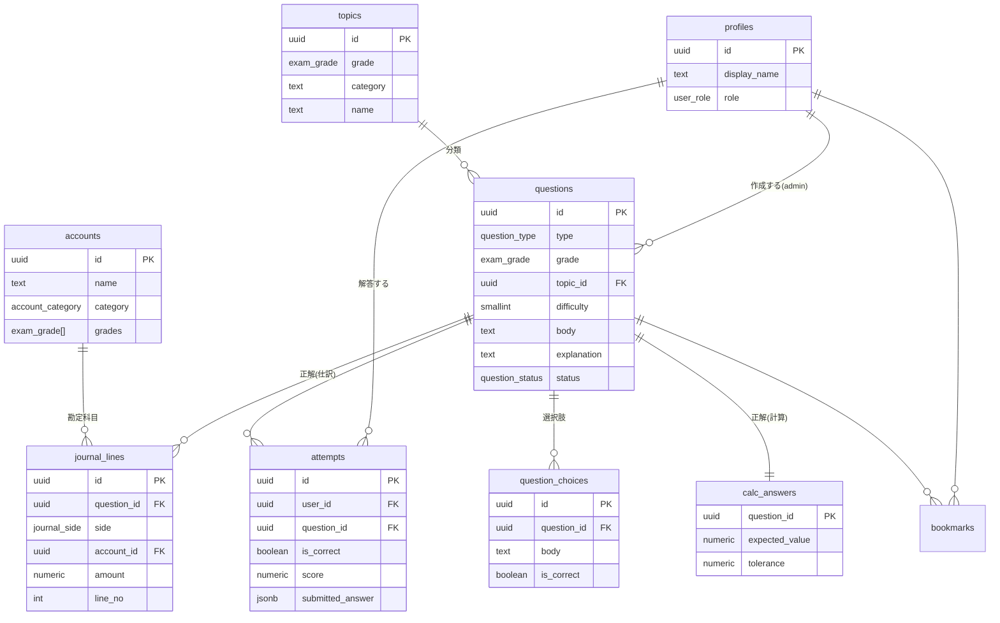

# データモデル設計書（権威ある正本）

最終更新: 2026-07-09
ステータス: Draft（設計確定・実装前）

> 本アプリのデータベース設計の**単一の真実（Single Source of Truth）**。
> 各 UC の `data-model.md` はこの文書の該当スライスを参照する。
> 前提: **PostgreSQL / Supabase**（ADR-0002）。命名・共通規約は `../../99_standard/backend/02_DatabaseDesign.md`。

---

## 1. 設計方針

- **正解は構造化データで持つ**（採点はデータ比較で行う）。問題形式ごとにテーブルを分けて正規化する（ISS-B）。
- **錯題・正答率は集計で導出**する（専用テーブルを持たない。`attempts` から算出）。
- **正解データはユーザーに露出しない**。採点はサーバー側 RPC（`SECURITY DEFINER`）で行い、提出後に初めて正解・解説を返す。
- 金額は円単位の**非負整数**（`numeric(14,0)`）。小数は扱わない。

---

## 2. ER 図



---

## 3. 列挙型（enum）

```sql
create type user_role       as enum ('user', 'admin');
create type exam_grade      as enum ('grade_3', 'grade_2', 'grade_1');          -- 3級/2級/1級
create type question_type   as enum ('journal', 'choice', 'calc');             -- 仕訳/選択/計算
create type question_status as enum ('draft', 'published', 'archived');
create type journal_side    as enum ('debit', 'credit');                       -- 借方/貸方
create type account_category as enum ('asset','liability','equity','revenue','expense'); -- 資産/負債/純資産/収益/費用
```

---

## 4. テーブル定義（DDL）

### 4.1 profiles（ユーザー）
`auth.users` に 1:1 で紐づくアプリ側プロフィール。

```sql
create table profiles (
  id           uuid primary key references auth.users(id) on delete cascade,
  display_name text not null default '',
  role         user_role not null default 'user',
  created_at   timestamptz not null default now(),
  updated_at   timestamptz not null default now()
);
```

> サインアップ時にトリガ（`on auth.users insert`）で `profiles` 行を自動作成する。`role` の既定は `user`。

### 4.2 accounts（勘定科目マスタ）
仕訳の借方・貸方で選択させる。管理者が管理。

```sql
create table accounts (
  id         uuid primary key default gen_random_uuid(),
  code       text unique,                         -- 任意の勘定科目コード
  name       text not null,                       -- 現金 / 売掛金 / 売上 ...
  category   account_category not null,           -- 資産/負債/純資産/収益/費用
  grades     exam_grade[] not null default '{}',  -- 出題される級（複数）
  sort_order int not null default 0,
  is_active  boolean not null default true,
  created_at timestamptz not null default now(),
  updated_at timestamptz not null default now()
);
```

### 4.3 topics（分野マスタ）
級 × 商業/工業 × 細分野。問題の絞り込み・弱点分析の軸。

```sql
create table topics (
  id         uuid primary key default gen_random_uuid(),
  grade      exam_grade not null,
  category   text not null,          -- 商業簿記 / 工業簿記
  name       text not null,          -- 現金預金 / 減価償却 / 個別原価計算 ...
  sort_order int not null default 0,
  unique (grade, category, name)
);
```

### 4.4 questions（問題：共通部）

```sql
create table questions (
  id          uuid primary key default gen_random_uuid(),
  type        question_type not null,
  grade       exam_grade not null,
  topic_id    uuid references topics(id) on delete set null,
  difficulty  smallint not null default 1 check (difficulty between 1 and 5),
  body        text not null,                         -- 問題文
  explanation text not null default '',              -- 解説（提出後に表示）
  status      question_status not null default 'draft',
  created_by  uuid references profiles(id) on delete set null,
  created_at  timestamptz not null default now(),
  updated_at  timestamptz not null default now()
);
```

### 4.5 journal_lines（仕訳問題の正解行）
`type = 'journal'` の正解。借方・貸方それぞれ複数行（複合仕訳）を許容。

```sql
create table journal_lines (
  id          uuid primary key default gen_random_uuid(),
  question_id uuid not null references questions(id) on delete cascade,
  side        journal_side not null,
  account_id  uuid not null references accounts(id),
  amount      numeric(14,0) not null check (amount > 0),
  line_no     int not null default 0,
  unique (question_id, side, line_no)
);
```

### 4.6 question_choices（選択問題の選択肢）
`type = 'choice'`。`is_correct` は正解フラグ（複数正解も可）。

```sql
create table question_choices (
  id          uuid primary key default gen_random_uuid(),
  question_id uuid not null references questions(id) on delete cascade,
  label       text,                       -- ア/イ/ウ など（任意）
  body        text not null,
  is_correct  boolean not null default false,
  sort_order  int not null default 0
);
```

### 4.7 calc_answers（計算問題の正解：1:1）
`type = 'calc'`。許容誤差付き。

```sql
create table calc_answers (
  question_id    uuid primary key references questions(id) on delete cascade,
  expected_value numeric(14,0) not null,
  tolerance      numeric(14,0) not null default 0,   -- ±許容
  unit           text                                -- 円 / 個 など（表示用）
);
```

### 4.8 attempts（回答履歴）
1 提出につき 1 行。錯題・正答率の源泉。**挿入は採点 RPC 経由のみ**。

```sql
create table attempts (
  id               uuid primary key default gen_random_uuid(),
  user_id          uuid not null references profiles(id) on delete cascade,
  question_id      uuid not null references questions(id) on delete cascade,
  is_correct       boolean not null,
  score            numeric(5,4) not null default 0,   -- 0.0000〜1.0000（部分点）
  submitted_answer jsonb not null,                    -- ユーザー入力（監査・再表示用）
  duration_ms      int,                               -- 解答所要時間（任意）
  created_at       timestamptz not null default now()
);
```

### 4.9 bookmarks（お気に入り：Could）

```sql
create table bookmarks (
  user_id     uuid references profiles(id) on delete cascade,
  question_id uuid references questions(id) on delete cascade,
  created_at  timestamptz not null default now(),
  primary key (user_id, question_id)
);
```

---

## 5. 派生ビュー（錯題・統計）

集計はテーブルを増やさずビューで導出する。

```sql
-- 各(ユーザー,問題)の最新の解答のみ
create view latest_attempts as
select distinct on (user_id, question_id) *
from attempts
order by user_id, question_id, created_at desc;

-- 錯題（最新の解答が不正解の問題）
create view wrong_questions as
select la.user_id, la.question_id, la.created_at as last_attempt_at
from latest_attempts la
where la.is_correct = false;

-- 分野別 正答率（ダッシュボード用）
create view user_topic_stats as
select a.user_id,
       q.grade,
       q.topic_id,
       count(*)                                   as total,
       count(*) filter (where a.is_correct)       as correct,
       avg(a.score)                               as avg_score
from attempts a
join questions q on q.id = a.question_id
group by a.user_id, q.grade, q.topic_id;
```

> ビューは呼び出し元の権限（RLS）を継承する（`security_invoker`）ため、ユーザーは自分の行しか集計されない。

---

## 6. インデックス

```sql
-- 演習の絞り込み（公開問題を級・分野で）
create index idx_questions_filter on questions (status, grade, topic_id);

-- 履歴・錯題（最新解答の抽出に効く）
create index idx_attempts_user_question_created on attempts (user_id, question_id, created_at desc);
create index idx_attempts_user_created          on attempts (user_id, created_at desc);

-- 正解行の取得
create index idx_journal_lines_question  on journal_lines (question_id);
create index idx_question_choices_question on question_choices (question_id);
```

---

## 7. RLS（行レベルセキュリティ）

全テーブルで `enable row level security`。方針は `../../99_standard/security/02_RLSPolicy.md`。

| テーブル | user（一般） | admin |
|---|---|---|
| profiles | 自分の行 select/update（`role` 変更不可） | 全行 |
| accounts / topics | select（`is_active`）のみ | 全操作 |
| questions | `status='published'` の select のみ | 全操作 |
| **journal_lines / calc_answers** | **直接 select 不可**（正解漏洩防止） | 全操作 |
| question_choices | **`is_correct` を隠した公開ビュー経由のみ** | 全操作 |
| attempts | 自分の行 select のみ（insert は RPC 経由） | select 可 |
| bookmarks | 自分の行のみ全操作 | — |

ポイント（例）:

```sql
-- questions: 公開のみ閲覧
create policy questions_select_published on questions
  for select using (status = 'published');

-- admin 判定用ヘルパ
create function is_admin() returns boolean language sql stable as $$
  select exists (select 1 from profiles where id = auth.uid() and role = 'admin');
$$;

create policy questions_admin_all on questions
  for all using (is_admin()) with check (is_admin());

-- attempts: 自分の行だけ閲覧（挿入ポリシーは作らない＝直接 insert 不可）
create policy attempts_select_own on attempts
  for select using (user_id = auth.uid());
```

**選択肢の公開ビュー**（`is_correct` を除外）:

```sql
create view question_choices_public
with (security_invoker = true) as
select id, question_id, label, body, sort_order
from question_choices
where question_id in (select id from questions where status = 'published');
```

---

## 8. 採点フロー（サーバー側 RPC）

正解データを露出させないため、採点は `SECURITY DEFINER` 関数で行い、`attempts` を記録して結果を返す。

```sql
-- 戻り値: { is_correct, score, explanation, correct_answer }
create function grade_and_record(p_question_id uuid, p_answer jsonb, p_duration_ms int default null)
returns jsonb
language plpgsql
security definer
set search_path = public
as $$
declare
  v_type    question_type;
  v_correct boolean := false;
  v_score   numeric := 0;
  v_expl    text;
begin
  -- 公開問題のみ採点対象
  select type, explanation into v_type, v_expl
  from questions where id = p_question_id and status = 'published';
  if not found then
    raise exception 'question not found or not published';
  end if;

  if v_type = 'journal' then
    -- 借方・貸方それぞれ (account_id, amount) の多重集合が完全一致か（順不同）
    v_correct := is_journal_correct(p_question_id, p_answer);
  elsif v_type = 'choice' then
    v_correct := is_choice_correct(p_question_id, p_answer);
  elsif v_type = 'calc' then
    v_correct := is_calc_correct(p_question_id, p_answer);
  end if;

  v_score := case when v_correct then 1 else 0 end;  -- レベルA（完全一致）。部分点は後付け

  insert into attempts (user_id, question_id, is_correct, score, submitted_answer, duration_ms)
  values (auth.uid(), p_question_id, v_correct, v_score, p_answer, p_duration_ms);

  -- 提出後は正解・解説を返してよい
  return jsonb_build_object(
    'is_correct', v_correct,
    'score', v_score,
    'explanation', v_expl,
    'correct_answer', get_correct_answer(p_question_id)
  );
end;
$$;
```

仕訳採点（順不同の多重集合一致）の考え方:

```sql
-- 概念: 正解の (side, account_id, amount) 集合 と 提出集合 が完全一致
-- 実装は正解行を集約し、p_answer(jsonb 配列)を展開して件数付きで比較する。
-- 借方合計 = 貸方合計 の検証はクライアントで事前に行い、崩れていれば提出前に警告（ISS-D）。
```

> クライアント側 `domain/scoring.ts` にも同じロジックを実装し、F1（モック/オフライン）ではそれで採点。
> F2 以降はこの RPC を**正**とし、クライアント採点は即時フィードバック用に留める。

---

## 9. マイグレーション / シード方針

- 順序: `enums → profiles(+signup trigger) → accounts → topics → questions → journal_lines/question_choices/calc_answers → attempts/bookmarks → views → RLS → RPC`。
- Supabase migrations（SQL）で管理。本番未稼働のため `db reset` で作り直し可。
- シード: 勘定科目マスタ、分野マスタ、各級のサンプル問題を数問（ISS-E で数量確定）。

---

## 10. 未解決事項

`../../../03_specs/INI-001-mvp/UC-001-quiz/issues.md` の ISS-E（問題データ調達）/ ISS-F（出題単位・SRS）を参照。
部分点（採点レベルB/C）は `score` 列で拡張可能な設計にしてある。

---

## 変更履歴
| 日付 | 変更内容 |
|------|---------|
| 2026-07-09 | 初版作成（正規化スキーマ・RLS・採点RPC を確定） |
